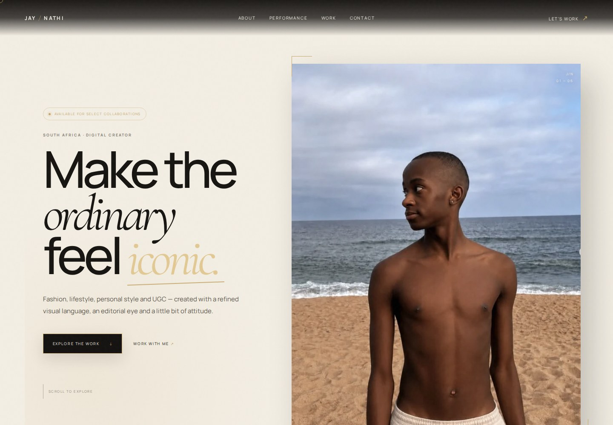
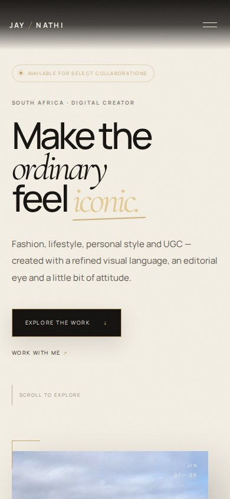

# JAY / NATHI — Creator Website

**Personal project · HTML/CSS · JavaScript · GitHub Pages**

A deployed creator portfolio presenting visual work, fashion and lifestyle content, creator statistics and collaboration contact links.

[View the website](https://nkosinathi-bit.github.io/media-kit/)

## Visual preview

Actual Chromium browser captures of the running site. 

Mobile browser preview

Desktop: 1440 × 1000 · Mobile: 390 × 844. [Capture source and provenance](docs/screenshots/capture.json).

## Frontend features

- Responsive layouts and accessible mobile-menu controls.
- Scroll-based reveals and animated counters.
- WebP portfolio images with PNG fallbacks.
- Working email, Instagram and TikTok links.
- Visible content when JavaScript is disabled.
- Automated browser checks and static-site deployment.

## View locally

~~~bash
python -m http.server 8000
~~~

Open http://localhost:8000.

## Folder organisation

| Path | Responsibility |
| --- | --- |
| index.html, styles.css, script.js | Static frontend |
| assets/ | Portfolio image assets |
| favicon.svg, robots.txt, sitemap.xml | Site metadata |
| backend/dotnet/ | Optional C# API prototype |
| backend/java/ | Optional Java/Spring configuration and starter reference |
| .github/ | Browser checks and Pages deployment |

The Pages workflow publishes only frontend files and assets.

## Backend scope

The live frontend uses email links for contact. It is not connected to a deployed backend.

The C# prototype validates sample contact requests but does not send email or save messages. The Java reference must be placed in the appropriate source directory before it can be built. See [backend notes](backend/README.md).

## Deployment

The existing workflow publishes to GitHub Pages on pushes to main. In Settings → Pages, GitHub Actions is the configured publishing source.

**Maintained by:** Nkosinathi Mathenjwa

